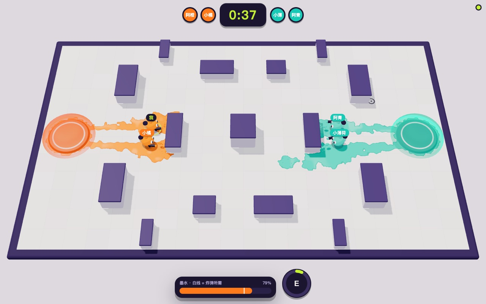
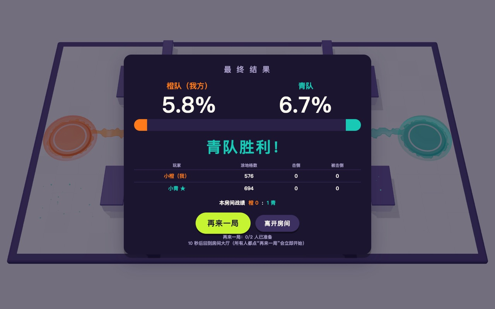
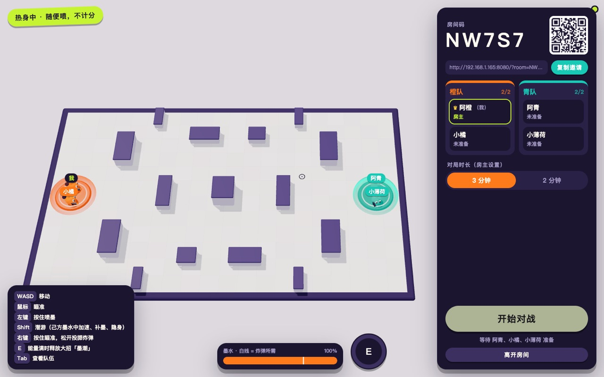
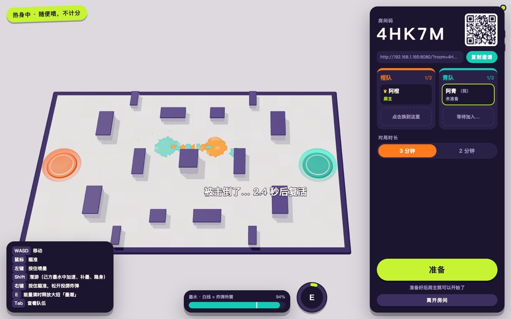

# 泼色竞技场（Splash Arena）

一款在浏览器里玩的**局域网实时联机团队涂地对战**。玩法参考斯普拉遁 3 的"占地对战"：两队各 1～2 人，3 分钟内用墨水涂满地面，时间到时**涂地面积大的一队获胜**。角色、场地、美术与音乐均为原创。

所有判定都在服务器上进行，每个浏览器看到的是同一个世界：同一片地面、同一颗子弹、同一次击倒。

| 对战 | 结算 |
|---|---|
|  |  |
|  |  |

> 本项目是受斯普拉遁玩法启发的同人性质原创作品，与任天堂（Nintendo）无任何关联，不包含其任何美术、音乐或商标素材。

---

## 一、启动（主机这台电脑）

需要 **Node.js 20 或更高版本**（已在 Node 24 上测试）。

> 只想玩、不想装依赖？运行 `npm run release` 会生成 `release/splash-arena.zip`：解压后双击 `start-mac.command`（Windows 用 `start-windows.bat`）即可启动，只需要 Node.js，不需要 `npm install`。

```bash
cd splash-arena
npm install        # 只需首次执行
npm start          # 构建前端并启动服务器
```

启动成功后终端会显示：

```
  泼色竞技场服务器已启动（正式模式）
  本机访问：   http://localhost:8080
  局域网访问： http://192.168.x.x:8080
```

- 主机自己用浏览器打开 `http://localhost:8080`。
- **同一局域网（同一个 Wi‑Fi / 路由器）的其他电脑**打开"局域网访问"那一行的地址。
- macOS 第一次启动时，系统可能弹窗询问"是否允许 node 接受传入网络连接"，请点**允许**，否则其他电脑连不进来。Windows 防火墙同理。
- 要换端口：`PORT=9000 npm start`。

停止服务器：在终端按 `Ctrl + C`。

## 二、开一局（不需要注册账号）

1. 主机点 **创建房间**，进入房间大厅，可以先在场地里热身（伤害生效，但不计分）。
2. 邀请朋友，任选一种方式：点 **复制邀请** 把链接发给对方；或让对方扫大厅右上角的二维码；或在首页输入 5 位**房间码**；首页的"局域网中的房间"列表也会自动列出房间，点一下就能加入。
3. 新加入的人会被自动分到人少的一队，在大厅里点空位可以换队。
4. 其他人点 **准备**，房主点 **开始对战**：3 秒倒计时后开局。
5. 时间到后进入结算：先显示双方涂地比例，再揭晓胜负和个人数据。所有人点 **再来一局** 会立即开下一局；如果有人没点，15 秒后自动回到大厅。房间会记录本房间的累计战绩。

人数：每局 2～4 名玩家（1v1、1v2、2v2 均可），另外最多 4 名观战者。房间满员或对局进行中加入的人自动成为观战者，下一局开始前有空位会自动入座。人少的一方会获得补偿：墨水消耗更低、复活更快。

## 三、操作

| 按键 | 作用 |
|---|---|
| `W` `A` `S` `D` | 移动 |
| 鼠标 | 瞄准 |
| 左键（按住） | 喷墨：涂地，同时可以攻击敌人（约 3 发击倒） |
| `Shift`（按住） | 潜游：在己方墨水中速度更快、快速补充墨水，并且对敌人隐身；在敌方墨水中会减速并持续掉血 |
| 右键（按住瞄准，松开投出） | 墨水炸弹：抛物线投出，落地后短暂延迟爆炸，大面积涂色并造成范围伤害，消耗 70% 墨水 |
| `E` | 大招"墨潮"：能量满时释放，原地炸开一圈墨水，随后 6 秒内墨水无限、射速更快 |
| `Tab`（按住） | 查看队伍 |
| `M` | 静音 / 取消静音 |
| `F3` | 显示网络调试面板（延迟、校正量、快照间隔等） |

小技巧：墨水不足时潜进自己的颜色里补墨；被击倒的位置会炸开一大片对方的颜色，所以别轻易冲进敌阵。最后 1 分钟背景音乐会加快。

## 四、刷新、掉线和离开

| 情况 | 结果 |
|---|---|
| 刷新页面、短暂断网 | 自动重连，回到原来的座位和队伍，地面和比分不丢失（实测刷新后约 1 秒内恢复） |
| 掉线后 60 秒内回来 | 保留座位；对局中角色停在原地（不会被打），队友和对手的界面上会标注"离线" |
| 掉线超过 60 秒 | 座位被释放 |
| 对局中某一队全部离线超过 10 秒 | 对方以"对手弃权"获胜（如果两队都已全员离线，则按当前涂地面积结算） |
| 点"离开房间" | 立即释放座位；房主离开时房主身份自动转给下一位玩家 |
| 用浏览器的"复制标签页"打开同一房间 | 新标签页接管座位，旧标签页提示"已在别处打开"（直接在新标签页打开邀请链接，则会作为另一名新玩家加入） |
| 房间里所有人都离开 | 房间销毁 |
| 服务器重启 | 所有房间清空（局域网版本不做持久化） |

## 五、技术要点

- **服务器权威**：服务器以 60 Hz 推进模拟，每秒向客户端发送 30 次快照。客户端只发送"按键与瞄准方向"，位置、命中、涂色、胜负都由服务器计算，修改客户端无法作弊。
- **本地预测 + 服务器校正**：自己的角色立即响应按键；收到服务器状态后，用权威状态重放尚未确认的输入，误差以视觉偏移的形式平滑淡出。客户端和服务器共用同一份步进函数（`shared/sim.ts`），实测校正量小于 0.001。
- **他人角色**：用服务器快照的位置与速度做短时外推，并平滑追赶。
- **地面同步**：只广播变化的格子（增量），倒计时开始和重连时发送完整地面，所以各端涂色格数完全一致。
- **安全**：所有消息都经过 zod 校验和长度限制；按连接限流；超出速率或格式错误会断开连接；检查 WebSocket 来源（Origin），并限制单个 IP 的连接数；座位令牌只保存在当前标签页（sessionStorage）。
- **技术栈**：TypeScript、Three.js（3D 卡通渲染、涂色贴图）、Node.js + ws（WebSocket）、Vite、Web Audio（程序化音效）、Vitest、Playwright。

## 六、开发

```bash
npm run dev          # 开发模式：前端热更新，服务器同样监听 8080
npm test             # 单元测试 + 无头机器人联机集成测试
npm run typecheck    # TypeScript 类型检查
SA_ROUND_SEC=30 npm start   # 仅用于测试：把对局缩短为 30 秒
npm run release      # 生成可直接运行的发布包 release/splash-arena.zip
```

端到端测试（需要本机安装 Google Chrome，其他路径可用 `CHROME_PATH` 指定）：

```bash
SA_ROUND_SEC=25 npm start   # 终端 1：短对局服务器
npm run e2e                 # 终端 2：双浏览器完整流程（截图输出到 e2e-shots/）
node scripts/e2e/combat.mjs # 2v2 + 观战
node scripts/e2e/kill.mjs   # 交火、击倒与复活
```

目录结构：

```
shared/   客户端与服务器共用：常量、场地与碰撞、涂色网格、步进函数、通信协议与校验
server/   HTTP + WebSocket 入口、房间生命周期、权威世界模拟、日志
client/   页面、3D 场景、角色、特效、输入、网络连接、界面（首页/大厅/HUD/结算）、音效
tests/    共享逻辑单测与多客户端集成测试
scripts/  发布打包脚本与端到端测试脚本
docs/     设计文档、开发进度与截图
```

详细数值和协议见 [`docs/DESIGN.md`](docs/DESIGN.md)。

## 七、许可证

代码、美术与音乐均以 [MIT 许可证](LICENSE) 发布，版权所有 © 2026 Yuki Li。所用第三方库（Three.js、ws、zod、qrcode 等）各自遵循其 MIT 许可证，发布包内附有 `THIRD_PARTY_LICENSES.txt`。
